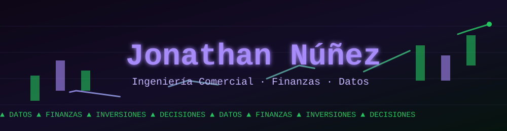

  

---

## 👋 Sobre mí

Soy estudiante de **Ingeniería Comercial con especialización en Finanzas** en la **UTEM**, en Santiago de Chile. Me interesa el análisis de datos aplicado a decisiones financieras: construir reportes, medir variaciones y convertir cifras en información útil para quien decide.

Mi objetivo es integrarme a equipos de **Corporate Finance** o **análisis de inversiones**, usando Excel, SQL y Power BI como herramientas principales.

---

## 🛠️ Herramientas

---

## 🌐 Idiomas

Comunicación profesional fluida, tanto escrita como oral.

---

## 💼 Experiencia

<b>Práctica profesional · Teck Resources Limited</b> · Febrero 2026 · Las Condes (híbrida)

 

**Área:** Finanzas

- 🧾 **Conciliación de facturas de tarjetas de crédito**, cruzando los registros para detectar diferencias antes de cerrar el periodo.
- 🔍 **Revisión de documentos previa a su carga al sistema**, para prevenir errores en la información registrada.
- 📑 **Apoyo en la elaboración de los Estados Financieros** del periodo.

---

## 📊 Proyectos

> 🚧 **En desarrollo:** estoy construyendo proyectos de análisis financiero con Power BI, SQL, Python y Excel. Los publicaré aquí con su pregunta de negocio, datos, método y conclusiones.

| Área de proyecto | Enfoque | Herramientas |
|:--|:--|:--|
| 🧮 Estados financieros | Análisis de razones de liquidez, endeudamiento y rentabilidad | Excel, Python |
| 🔗 Automatización de datos | Limpieza, cruce y conciliación de datos financieros | SQL, Python |
| 🏦 Inversiones y automatización | Análisis de desempeño de activos y automatización de su seguimiento y comparación de retornos | Python, Excel |
| 🛡️ Control de riesgo | Seguimiento de indicadores de riesgo y exposición financiera | Power BI, Excel |

---

## 🎓 Formación y certificaciones

- 🎓 **Ingeniería Comercial**, Universidad Tecnológica Metropolitana (UTEM), en curso
- 📜 **Análisis de datos**, Academia IPSDATAX
    
  

- 📜 **IA para Excel**, Academia IPSDATAX
    
  

---

### 📫 ¿Conversamos?

Si tienes una oportunidad en análisis de datos o finanzas, escríbeme.

  

